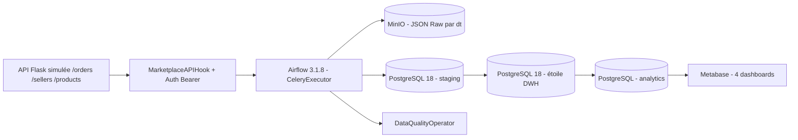
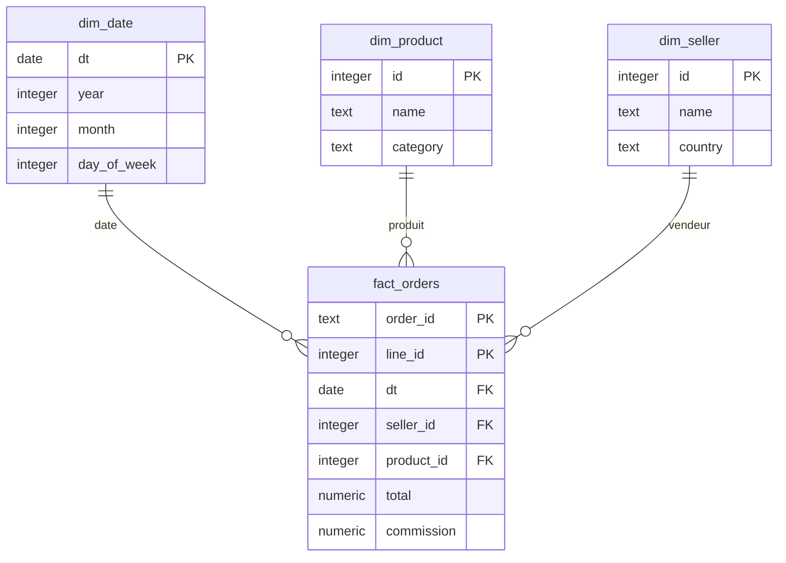

# Projet final A — Maelys MarketPlace Analytics

**Projet pédagogique Data Engineering — version Codespaces, sans Docker Desktop sur ton PC.**

## Objectif et périmètre

Un pipeline ELT complet ingère les commandes de l'API de marketplace, archive les JSON dans MinIO, transforme les données en un Data Warehouse PostgreSQL 18, expose des KPI dans Metabase, et démontre l'**idempotence**. Les données sont **fictives**.

**IMPORTANT :** le cahier des charges joint mentionne une API Flask déjà fournie dans un kit et un fichier « Documentation commune.html » non joints. Cette archive inclut **une API simulée compatible avec les routes annoncées** ; elle peut nécessiter une adaptation si le professeur impose le kit API d'origine. L'exécution Docker intégrale reste à valider dans Codespaces.

## Architecture



### Modèle de données



Le grain de la table de faits est **une ligne d'article d'une commande** (clé primaire composite `order_id, line_id`). 3 dimensions : vendeur, produit, date. Montant de commission : **12 %**. Les commandes annulées sont archivées mais exclues du CA analytique.

## Démarrage dans GitHub Codespaces (pas d'installation sur Windows)

### Étape A — Importation

1. Dans GitHub, crée un dépôt **privé** (par exemple `maelys-marketplace`).
2. Décompresse l'archive fournie et ajoute son **contenu** à la racine du dépôt (inclure `.devcontainer` et les fichiers commençant par `.`). GitHub Web → **Add file → Upload files**, puis Commit.
3. Clique **Code → Codespaces → Create codespace on main**. Sélectionne une machine **4 cœurs / 16 Go RAM** si elle est disponible et si ton quota le permet. Le `.devcontainer` prépare un environnement Docker distant. Ne pas rendre publics les ports ou le dépôt.
4. Ouvre un terminal VS Code dans Codespaces, à la racine du projet.

### Étape B — Lancer les services

```bash
bash scripts/start.sh
```

La première fois, les images Docker sont téléchargées **sur le serveur Codespaces**, ce qui peut prendre plusieurs minutes. La commande crée `.env` avec des mots de passe aléatoires (non suivis par Git), valide Compose, construit les images et démarre les services.

Contrôler les services :

```bash
docker compose ps
docker compose logs --tail=80 airflow-apiserver
curl http://localhost:5000/health
```

La liste des identifiants se trouve **uniquement dans ton `.env` privé** :

```bash
grep -E '^(AIRFLOW_ADMIN_|METABASE_ADMIN_|MINIO_ROOT_)' .env
```

### Étape C — Airflow et tests

Le port **8080** apparaît dans l'onglet **Ports**. Cliquer sur l'URL de redirection pour l'interface Airflow. Identifiant et mot de passe : variables `AIRFLOW_ADMIN_USER` et `AIRFLOW_ADMIN_PASSWORD` de `.env`.

```bash
docker compose exec -T airflow-worker airflow dags list
docker compose exec -T airflow-worker pytest /opt/airflow/tests -v
```

Déclencher le traitement d'une journée :

```bash
docker compose exec -T airflow-worker airflow dags test marketplace_orders_ingest_daily 2026-04-07
```

Prouver l'idempotence :

```bash
bash scripts/check_idempotence.sh 2026-04-07
```

Alimenter 10 jours pour les graphiques :

```bash
python3 scripts/backfill.py --days 10
```

Pour plus d'historique : `python3 scripts/backfill.py --days 30` (plus long et consomme plus de quota Codespaces).

Vérifier PostgreSQL :

```bash
# Ici, le mot de passe n'est PAS nécessaire dans le conteneur : connexion locale du super-utilisateur créé
DWH_USER=$(sed -n 's/^DWH_USER=//p' .env)
docker compose exec -T postgres-dwh psql -U "$DWH_USER" -d dwh -c 'SELECT dt, total_orders, total_revenue FROM analytics.daily_summary ORDER BY dt DESC LIMIT 10;'
```

### Étape D — Metabase et dashboards

Dans le terminal, lancer le script **avant de finaliser une éventuelle inscription manuelle** dans Metabase :

```bash
python3 scripts/bootstrap_metabase.py
```

Ensuite, ouvrir le port **3000** dans Codespaces. Le script crée l'administrateur, relie Metabase à PostgreSQL et prépare **4 dashboards** (2 MVP + 2 bonus). Il utilise les valeurs du `.env`. Il est conçu pour être relancé : les dashboards déjà nommés sont conservés.

En cas d'erreur de l'API Metabase : lire **`docs/METABASE_MANUEL.md`** pour créer les dashboards avec l'interface visuelle et les SQL déjà prêts.

Dashboard 1 : **Executive Summary** (CA du dernier jour, CA 30 jours, top 5 vendeurs). Dashboard 2 : **Top Sellers** (top 10 vendeurs, évolution des top 3, vendeurs inactifs). Bonus : **Finance et commissions**, **Catégories produits**.

### Ports à ouvrir (onglet Codespaces → Ports)

| Port | Service | Accès |
|---|---|---|
| 8080 | Airflow | Identifiants `.env` |
| 3000 | Metabase | Identifiants `.env` |
| 9001 | Console MinIO | `MINIO_ROOT_USER` + `MINIO_ROOT_PASSWORD` |
| 5000 | API Flask | `/health` public, autres routes Bearer |

**Important :** garder les ports en visibilité **Private**. Codespaces peut imposer une authentification GitHub aux visiteurs. Le projet n'est pas destiné à être exposé publiquement.

## Arborescence

```text
.devcontainer/devcontainer.json   # Configuration Codespaces
api/app.py                        # API REST simulée déterministe
plugins/marketplace_hook.py       # Hook authentifié (Bearer via Connection)
plugins/marketplace_data.py       # Transformations métier
plugins/data_quality_operator.py  # 3 contrôles qualité configurables
dags/marketplace_orders.py        # Pipeline principal, branchement qualité
dags/marketplace_dims.py          # Dimensions quotidiennes
dags/marketplace_aggregate.py     # Réagrégation manuelle
dags/marketplace_anomaly.py       # Bonus : anomalie <70% du CA moyen 7j
init-db/schema.sql                # Base en étoile + tables analytics
sql/transform.sql                 # DELETE + INSERT par dt
sql/aggregate.sql                 # CA, commissions, catégories, vendeurs
scripts/start.sh                  # Démarrage Codespaces
scripts/backfill.py               # Historique pour les dashboards
scripts/bootstrap_metabase.py     # 4 dashboards via API Metabase
scripts/check_idempotence.sh      # Démonstration test du professeur
tests/                            # Tests Python, API, DAG, idempotence
```

## Garanties et points à vérifier

- DAG principal **idempotent** : il remplace les lignes du même jour au lieu d'ajouter des doublons.
- Erreurs API HTTP : retry avec backoff, timeout, Bearer lu depuis Connection Airflow.
- DQ : pas de date future, pas de valeur nulle, staging non vide ; branche d'alerte si aucune ligne.
- Agrégations journalisées (recalcul après succès de la transformation).
- 4 DAGs, 4 dashboards (les dashboards sont **créés à l'exécution** du script bootstrap et pas contenus en base dans le ZIP).
- Les tests peuvent être lancés avant et après exécution, mais seul un lancement Codespaces permet de prouver que **tous les composants interagissent réellement**.

## Arrêt et sauvegarde

```bash
docker compose down
```

Cette commande conserve les volumes. **Ne pas faire `docker compose down -v`** sauf volonté explicite de supprimer TOUTES les données et dashboards. Le stockage et les heures de calcul de Codespaces sont soumis aux quotas GitHub : arrêter le codespace après la séance de travail.

## Limites et responsabilité pédagogique

Ce projet est une démonstration technique, **pas une infrastructure de production**. Les comptes, ports et secrets sont locaux au projet. Les faux clients ne sont pas des personnes réelles. Les points à valider dans Codespaces sont listés dans **`docs/GRILLE_VALIDATION.md`**. Pour les choix, écarts et la documentation commune manquante, voir **`docs/CHOIX_TECHNIQUES.md`**.

## Ce qu'il faut rendre au professeur

1. Le dépôt GitHub (ou une archive ZIP du code) sans le fichier `.env` ni les volumes Docker.
2. Le présent README et `docs/CHOIX_TECHNIQUES.md` (conception, architecture, limites).
3. Des captures **réelles** après exécution montrant : DAG `marketplace_orders_ingest_daily` réussi, SQL `COUNT(*)` après deux exécutions, les deux dashboards Metabase et les tests pytest.
4. La grille de validation complétée (`docs/GRILLE_VALIDATION.md`).

Les captures d'écran ne sont pas incluses : elles doivent être réalisées sur tes services Codespaces, pas fabriquées.

### En cas de problème au démarrage

```bash
bash scripts/diagnostics.sh
```

Copie la partie de log contenant l'erreur dans notre conversation pour obtenir une correction ciblée.
